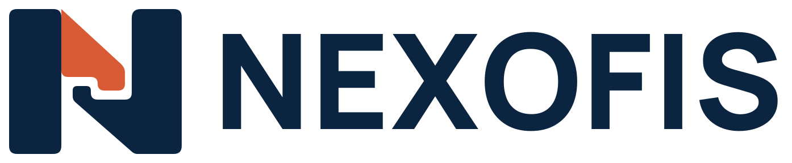
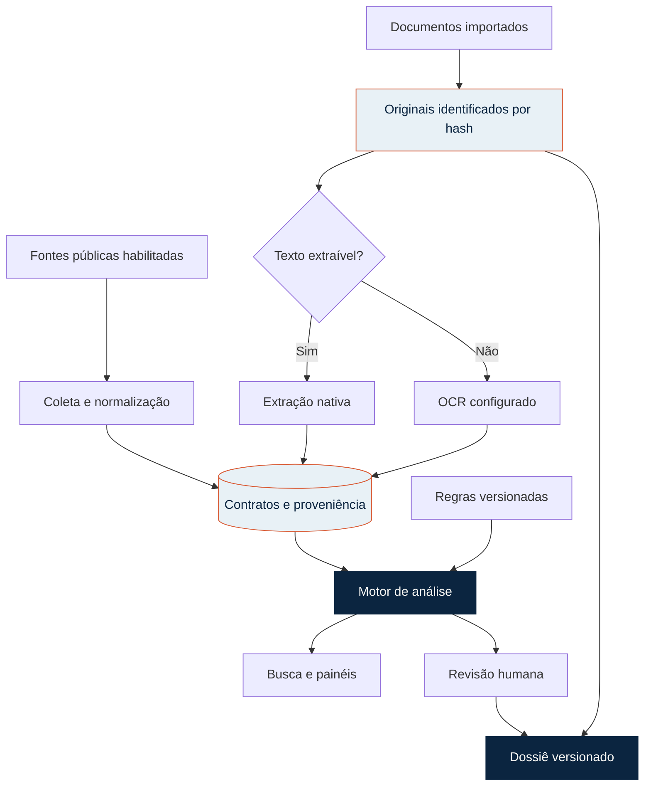
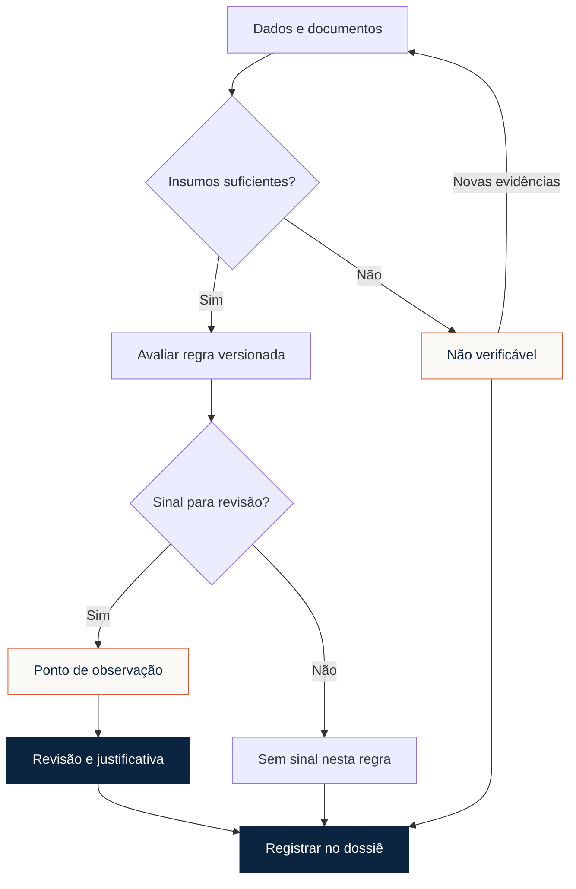

<p align="center">
  <picture>
    <source media="(prefers-color-scheme: dark)" srcset="./public/brand/nexofis-logo-horizontal-reverse.svg" />
    
  </picture>
</p>

<h1 align="center">NEXOFIS</h1>

<p align="center">
  <strong>Inteligência sobre contratos públicos, com evidências que podem ser conferidas.</strong>
</p>

<p align="center">
  Pesquisa municipal · Análise documental · Execução financeira · Auditoria reprodutível
</p>

<p align="center">
  <a href="./LICENSE"></a>
  <a href="https://github.com/devdudumuniz/NEXOFIS/actions/workflows/ci.yml"></a>
  <a href="./package.json"></a>
</p>

<p align="center">
  <a href="#visao-geral">Visão geral</a> ·
  <a href="#recursos">Recursos</a> ·
  <a href="#arquitetura">Arquitetura</a> ·
  <a href="#metodologia">Metodologia</a> ·
  <a href="#instalacao">Instalação</a> ·
  <a href="#contribuicao">Contribuição</a>
</p>

---

<a id="visao-geral"></a>

## Visão geral

O **NEXOFIS** é uma plataforma aberta de análise de contratos públicos brasileiros. Reúne pesquisa por município, órgão, fornecedor e contrato, extração documental, indicadores de risco e revisão humana em uma mesma investigação.

Seu objetivo é ajudar a responder **o que foi contratado, quanto foi pago, o que foi entregue e quais evidências sustentam cada conclusão**. A análise combina registros estruturados e documentos, preservando a origem das informações e as limitações de cobertura.

Desenvolvido por **Eduardo Muniz — DM Technology**.

> [!IMPORTANT]
> Os indicadores orientam a apuração. Uma anomalia estatística ou inconsistência documental não constitui, isoladamente, prova de fraude. A conclusão depende das evidências, do contexto e da revisão humana.

### Comece pela pergunta

| Você informa | A investigação pode explorar |
|---|---|
| **Município ou código IBGE** | Contratos disponíveis, órgãos, secretarias e contexto territorial. |
| **Secretaria ou órgão** | Despesas e contratações associadas à unidade, conforme os registros coletados. |
| **CNPJ** | Contratos publicados no PNCP, papel da empresa e informações cadastrais disponíveis. |
| **Número ou referência de contrato** | Objeto, fornecedor, vigência, valores e documentos relacionados. |
| **Documento** | Extração de campos, evidências e vínculo com o contrato, quando identificável. |

<a id="recursos"></a>

## Recursos

| Área | Capacidades |
|---|---|
| **Pesquisa** | Busca municipal, filtros por órgão e período, consulta nacional de contratos no PNCP e índice local persistente. |
| **Fornecedores** | Normalização de CNPJ numérico e alfanumérico, distinção entre fornecedor, órgão contratante e subcontratado. |
| **Documentos** | Validação de formato, preservação do original, identificação por SHA-256, extração nativa e OCR configurável. |
| **Preços** | Comparação de itens com referência válida e benchmarking horizontal por mediana e desvio absoluto mediano. |
| **Regras e sanções** | Catálogo normativo temporal e análise de registros de sanção, considerando os dados disponíveis sobre efeito, período e alcance. |
| **Execução e entrega** | Separação dos estágios financeiros e indicadores de gasto por entrega, quando existirem dados compatíveis. |
| **Investigação** | Achados identificados, justificativas de revisão, histórico e dossiês com snapshot dos dados analisados. |
| **Inteligência documental** | Oito trilhas de cronologia empresarial, concentração e vínculos societários/familiares documentados, com vigência, cobertura e revisão humana. |
| **Acervo restrito** | Evidências privadas por contrato, acesso identificado, versões encadeadas por hash e exportação reproduzível com verificador independente. |
| **Exportação** | PDF, Markdown, JSON estruturado do dossiê e JSON no formato OCDS 1.1. |
| **Experiência** | Temas claro e escuro, navegação por contexto, filtros e identidade visual NEXOFIS. |

A disponibilidade de uma análise depende dos documentos, das fontes habilitadas e da configuração da instalação. Uma tela disponível não implica cobertura completa de todas as fontes.

### Investigação forense de fornecedores

Na aba **Investigação Forense** do dossiê, analistas e administradores podem investigar:

- Assinatura no mesmo dia ou no dia seguinte ao evento cadastral, mantendo constituição, inscrição e início de atividade separados.
- Alterações societárias próximas da contratação e concentração no universo de contratos efetivamente observado.
- Relações documentadas entre fornecedor, pessoas, agentes públicos e familiares, com identidade, função e vigência verificadas.
- Vínculos empresariais comuns entre participantes de um mesmo lote, apoiados em documentos.

O QSA automático entra como extrato minimizado de um provedor intermediário. Nomes iguais não resolvem identidades; parentesco exige documentação e revisão. “Um contrato encontrado” não significa “único contrato existente”. O módulo organiza elementos para apuração, sem atribuir culpabilidade ou certificar admissibilidade judicial.

O pacote exportado conserva as entradas da análise, versão do motor, fontes e histórico. Os originais privados acompanham um manifesto e podem ser conferidos fora da plataforma:

```powershell
npx tsx scripts/verify-investigation.ts .\investigacao.json .\originais
```

Consulte o [guia de investigação documental](./docs/INVESTIGACAO_FORENSE.md) para metodologia, fórmulas, esquema, API, limites de acesso e procedimentos de preservação.

<a id="arquitetura"></a>

## Arquitetura

### Da fonte ao dossiê

Registros estruturados seguem para normalização. Documentos passam por extração, com OCR quando necessário e disponível. Os resultados alimentam o motor de regras e permanecem vinculados às fontes utilizadas.



### Componentes

| Camada | Implementação | Responsabilidade |
|---|---|---|
| Interface | React, TypeScript e Tailwind CSS | Pesquisa, leitura de evidências, revisão e exportação. |
| Aplicação | Node.js e Express | Rotas, identidade, ingestão e coordenação das análises. |
| Persistência principal | SQLite em modo WAL | Contratos, revisões, dossiês, metadados e estado operacional. |
| Originais | Armazenamento por hash | Preservação dos arquivos recebidos para consulta e reprocessamento. |
| Extração documental | Parser nativo, Docling Serve e PaddleOCR | Texto, estrutura e OCR, conforme o documento e os serviços configurados. |
| Análise | Regras TypeScript versionadas | Cálculos, enquadramento temporal e geração de indicadores. |

O repositório também contém fila persistente de ingestão, adaptador PostgreSQL e migrações. **O servidor padrão utiliza SQLite.** Disponibilizar o serviço PostgreSQL não alterna automaticamente o armazenamento da aplicação; a integração deve ser verificada no ambiente escolhido.

Referências de implementação: [servidor](./server.ts), [armazenamento](./src/server/storage.ts), [extração](./src/server/ocrEngine.ts), [fila](./src/server/jobQueue.ts) e [adaptador PostgreSQL](./src/server/postgresStore.ts).

<a id="metodologia"></a>

## Metodologia de análise

As fórmulas tornam explícita a leitura dos indicadores. Sua aplicação exige insumos válidos, unidades compatíveis e cobertura conhecida. O código das regras permanece a referência para condições de elegibilidade e tratamento de exceções.

### 1. Obrigação contratada e execução financeira

Valor contratado, empenhado, liquidado e pago são apresentados como medidas distintas. Para relacionar desembolso apurado e obrigação vigente:

```math
\operatorname{ExecucaoFinanceira}(\%)
= 100\cdot\frac{P_{\mathrm{apurado}}}{V_{\mathrm{contratual\ atualizado}}}
```

`P_apurado` representa o total de pagamentos considerado na análise, com o tratamento dos eventos e estornos registrados. O denominador deve ser positivo, e os valores precisam corresponder ao mesmo contrato e escopo.

- Empenho, liquidação e pagamento não são somados como três desembolsos diferentes.
- Eventos de mesmo valor e data precisam de identidade para serem reconciliados.
- Sem execução financeira coletada, a leitura adequada é **não verificado**, sem presumir pagamento zero.
- O percentual financeiro, sozinho, não comprova a entrega física do objeto.

### 2. Desvio de preço sobre itens comparáveis

Considere `C` como o conjunto de itens com referência válida, `q` como quantidade, `p` como preço contratado e `r` como preço de referência:

```math
D_C(\%)=
100\cdot\left(
\frac{\sum_{i\in C}q_i p_i}
     {\sum_{i\in C}q_i r_i}
-1\right)
```

O mesmo conjunto de itens entra nos dois lados da comparação. Itens sem referência válida ficam fora do cálculo e reduzem a cobertura da análise. A comparação requer especificações, unidades, condições de fornecimento e base temporal compatíveis. Sem itens comparáveis ou denominador positivo, não há desvio verificável.

**Exemplo didático:** um item contratado por 100 e referenciado a 100 tem desvio de 0%. Outro item de 900 sem referência não pode transformar essa comparação em um alerta de 900%.

### 3. Benchmarking horizontal com mediana e MAD

Para preços normalizados `x₁ … xₙ` de um grupo comparável, a mediana representa o centro do grupo e o MAD representa a dispersão:

```math
\begin{aligned}
m &= \operatorname{mediana}(x_1,\ldots,x_n) \\
\operatorname{MAD} &= \operatorname{mediana}\left(|x_j-m|\right) \\
R &= \frac{x_{\mathrm{analisado}}}{m} \\
Z^{*} &= 0{,}6745\cdot\frac{x_{\mathrm{analisado}}-m}{\operatorname{MAD}}
\end{aligned}
```

| Medida | Como interpretar |
|---|---|
| **Mediana** | Preço central do grupo de referência. |
| **Razão `R`** | Quantas vezes o preço analisado representa a mediana; exige mediana positiva. |
| **MAD** | Dispersão absoluta dos preços em torno da mediana. |
| **Escore robusto `Z*`** | Distância relativa à dispersão; calculável quando o MAD é positivo. |

Quando `MAD = 0`, `robustZ` permanece `null`. A razão pode continuar informativa, com amostra e comparabilidade declaradas. Não se cria um denominador artificial para produzir um escore.

Os modos `same_supplier` e `market` distinguem comparações do mesmo fornecedor e de mercado. Escopo, SLA, licenciamento, unidade e período precisam ser compatíveis. Valores corrigidos monetariamente devem compartilhar a mesma base; uma série incompleta não autoriza misturar valores nominais e corrigidos.

### 4. Gasto por entrega verificada

O custo unitário contextualiza o gasto com uma quantidade mensurável de entrega:

```math
C_{\mathrm{unitario}}=
\frac{G_{\mathrm{escopo}}}{Q_{\mathrm{verificada}}}
```

`G_escopo` é o gasto associado ao serviço e período analisados; `Q_verificada` é a quantidade de entrega correspondente, como procedimentos, refeições, licenças ou unidades medidas de obra.

O denominador deve ser positivo e ter fonte verificável. Ausência de medida impede calcular custo por entrega. População pode contextualizar uma comparação, mas não substitui automaticamente a unidade operacional do serviço. Esses indicadores dependem de dados de execução e produtividade efetivamente disponíveis.

Implementações: [motor de análise](./src/lib/riskEngine.ts), [benchmarking](./src/lib/benchmarkEngine.ts) e [catálogo temporal](./src/lib/legalRules.ts).

## Evidências e revisão humana

Cada resultado deve permitir conferir **fonte, insumos, regra, cálculo e decisão de revisão**. A identidade semântica do achado e o digest dos insumos ajudam a associar uma decisão ao contexto que foi analisado. O dossiê preserva um snapshot desse contexto.



O diagrama representa uma trilha de análise; a aplicabilidade de cada regra também depende de seu contexto e dos dados requeridos.

| Estado | Significado |
|---|---|
| **Não verificável** | Faltam insumos, cobertura ou condições para executar a verificação. |
| **Não aplicável** | A regra não se aplica ao contexto examinado. |
| **Ponto de observação** | Um sinal foi identificado e requer análise de contexto. |
| **Dado confirmado** | Um fato está sustentado pelos registros utilizados; isso não equivale a confirmar fraude. |

O SHA-256 permite comparar a integridade do conteúdo preservado. Ele não substitui a identificação da fonte, a comprovação de autoria ou uma assinatura digital. Novos dados ou novas regras podem exigir nova avaliação, preservando o histórico da versão anterior.

## Fontes e cobertura

| Fonte | Uso na plataforma | Limite a considerar |
|---|---|---|
| **PNCP** | Pesquisa e contextualização de contratos publicados. | A consulta abrange o que está publicado e acessível no portal. |
| **IBGE** | Identificação territorial por nome e código municipal. | Disponibilidade e atualização dependem da fonte e do cache utilizado. |
| **Provedores cadastrais de CNPJ** | Enriquecimento de dados empresariais. | São intermediários; disponibilidade e suporte a formatos variam por provedor. |
| **Portal da Transparência / CGU** | Consulta de registros CEIS, CNEP e CEPIM. | Exige configuração de acesso; o efeito de cada registro deve ser analisado. |
| **SICONFI / Tesouro Nacional** | Contexto fiscal agregado do ente. | Demonstrativo agregado não comprova pagamento de um contrato específico. |
| **Documentos importados** | Inclusão de documentos obtidos em outras fontes. | A análise depende de legibilidade, completude e identificação do documento. |

Contratos publicados exclusivamente em fontes locais podem exigir importação documental. Indisponibilidade de uma fonte ou busca incompleta não demonstra inexistência de contrato, pagamento ou sanção.

<a id="instalacao"></a>

## Instalação

### Pré-requisitos

- **Node.js 22 atualizado**, linha utilizada pela CI e pela imagem da aplicação.
- **Bun**, para instalar as dependências com o `bun.lock` versionado.
- **Git**, para obter o repositório.
- **Docker com Compose**, caso opte pela execução com os serviços definidos no projeto.

Bun é utilizado como gerenciador de dependências neste fluxo. Os scripts da aplicação e o uso de `node:sqlite` continuam exigindo Node.js.

### Windows — PowerShell

```powershell
git clone https://github.com/devdudumuniz/NEXOFIS.git
Set-Location NEXOFIS
if (-not (Test-Path .env)) { Copy-Item .env.example .env }
bun install --frozen-lockfile
npm run dev
```

<details>
<summary><strong>Linux, macOS ou WSL</strong></summary>

```bash
git clone https://github.com/devdudumuniz/NEXOFIS.git
cd NEXOFIS
[ -f .env ] || cp .env.example .env
bun install --frozen-lockfile
npm run dev
```

</details>

Revise as opções do [arquivo de exemplo](./.env.example) para habilitar as integrações desejadas. Acesse o endereço de desenvolvimento informado no terminal. Dados contratuais são obtidos pelas consultas e importações realizadas na aplicação.

### Docker Compose

Antes de iniciar em modo de produção, configure uma chave aleatória de sessão com pelo menos 32 caracteres em `NEXOFIS_SESSION_SECRET`, mantendo-a fora do controle de versão.

```bash
# Aplicação com SQLite e extração nativa
docker compose up --build -d

# Serviços opcionais de OCR
docker compose --profile full-ocr up --build -d
```

O perfil de OCR disponibiliza os serviços; suas conexões precisam estar configuradas para serem usadas pela aplicação. Consulte o [Compose](./docker-compose.yml) e o [guia operacional](./docs/ARQUITETURA_E_OPERACAO.md) para adaptar a instalação. O perfil PostgreSQL contém infraestrutura de integração e não troca, por si só, o armazenamento padrão.

## Validação e operação

### Verificações do projeto

```bash
npm run lint
npm test
npm run build
npx tsx scripts/smoke-api.ts
```

| Comando | Verificação |
|---|---|
| `npm run lint` | Checagem de tipos com `tsc --noEmit`, conforme o script atual. |
| `npm test` | Testes unitários e de regressão disponíveis no projeto. |
| `npm run build` | Compilação do frontend para produção. |
| `npx tsx scripts/smoke-api.ts` | Teste HTTP com processo real e armazenamento temporário. |

Os comandos descrevem como validar a versão utilizada. O resultado depende da execução no commit e ambiente correspondentes; o badge da CI aponta para o estado publicado do workflow.

### Acesso e revisão

O controle de acesso utiliza os papéis `admin`, `analyst` e `viewer`. A configuração padrão de produção exige autenticação e chave de sessão válida. O fluxo inclui cadastro do primeiro administrador e identificação do autor das revisões no servidor.

Consulte a [implementação de autenticação](./src/server/authMiddleware.ts) e a [política de segurança](./SECURITY.md). Não publique credenciais, dados pessoais desnecessários ou detalhes internos de uma instalação em issues e relatórios públicos.

### Backup e restauração

O [script de backup](./scripts/backup-restore.sh) cria um snapshot SQLite com `VACUUM INTO`, verifica sua integridade e empacota os objetos originais. O acervo privado de investigação é conferido por SHA-256 e incluído de acordo com as referências do snapshot; uma restauração com originais privados ausentes ou corrompidos é interrompida antes de substituir o destino.

```bash
bash scripts/backup-restore.sh backup-sqlite
```

Para restaurar, mantenha a aplicação parada, escolha o backup correto e preserve o arquivo de objetos que o acompanha. Substitua `NOME_DO_BACKUP.db` pelo nome real do arquivo:

```bash
bash scripts/backup-restore.sh restore-sqlite "backups/NOME_DO_BACKUP.db"
```

No Windows, os comandos Bash podem ser executados por WSL ou Git Bash. Planeje a recuperação de todos os dados persistentes da instalação, incluindo a fila, e valide a restauração antes de depender do backup operacionalmente.

<a id="contribuicao"></a>

## Documentação e contribuição

| Documento | Conteúdo |
|---|---|
| [Arquitetura e operação](./docs/ARQUITETURA_E_OPERACAO.md) | Serviços, configuração e procedimentos operacionais. |
| [Investigação documental de fornecedores](./docs/INVESTIGACAO_FORENSE.md) | Regras investigativas, relações documentadas, acervo privado, API e verificação independente. |
| [Matriz de rastreabilidade](./docs/MATRIZ_RASTREABILIDADE.md) | Acompanhamento dos achados e das verificações documentadas. |
| [Guia de contribuição](./CONTRIBUTING.md) | Orientações para contribuir com o projeto. |
| [Política de segurança](./SECURITY.md) | Canal e orientações para comunicar problemas de segurança. |
| [Código de conduta](./CODE_OF_CONDUCT.md) | Princípios de participação na comunidade. |

Contribuições úteis incluem novos conectores, melhoria de extração documental, regressões de regras, acessibilidade e documentação. Ao propor uma mudança, descreva o problema, o comportamento esperado, os testes executados e o impacto sobre dados e compatibilidade.

## Licença

O código-fonte do **NEXOFIS** é distribuído sob a **GNU Affero General Public License v3.0 — `AGPL-3.0-only`**. Consulte o texto integral em [LICENSE](./LICENSE).

A licença do software não altera os direitos e as condições aplicáveis aos dados, documentos e ativos de terceiros. O tratamento e a divulgação de informações devem respeitar a origem, a finalidade e a legislação aplicável, incluindo LAI e LGPD.

---

<p align="center">
  <strong>NEXOFIS</strong><br />
  Eduardo Muniz · DM Technology<br />
  Dados públicos conectados. Análises que podem ser conferidas.
</p>
