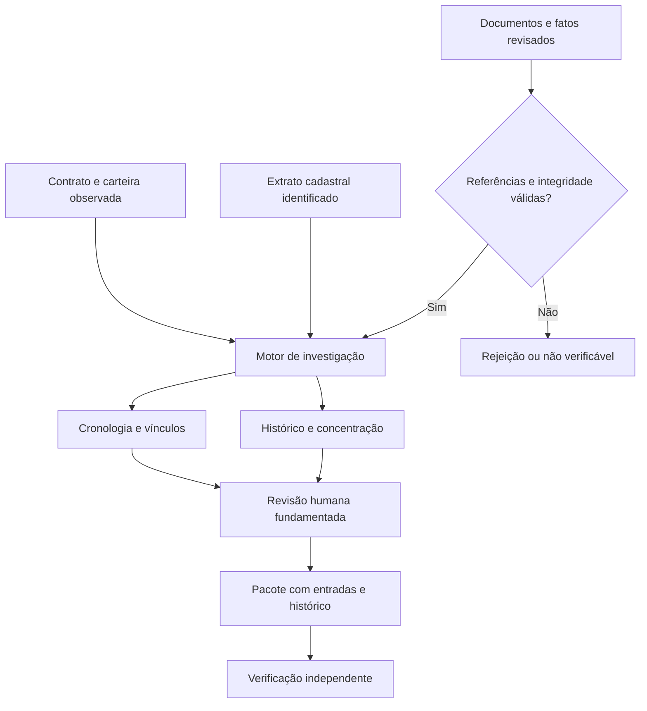
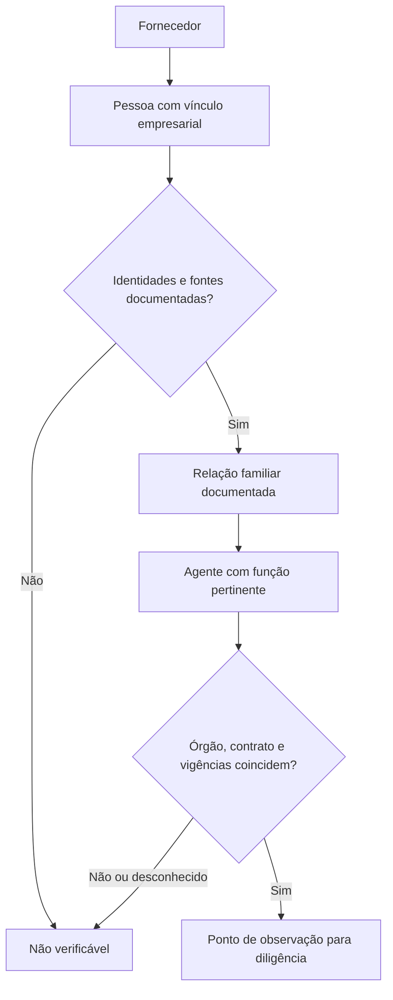

# Investigação documental de fornecedores

O módulo **Investigação Forense** organiza cronologia empresarial, contratos observados e vínculos documentados para apoiar diligências, auditorias e investigações. A unidade de análise é um contrato identificado. As conclusões continuam sujeitas à revisão do responsável pelo caso.

**Não há classificação automática de culpabilidade, empresa fictícia, parentesco ou corrupção.** Uma empresa recente, um único contrato localizado ou a condição de agente político são contextos investigativos; não demonstram ilícito isoladamente.

## 1. Fluxo na plataforma

1. Localize o contrato pelo município, CNPJ, número ou documento e abra o dossiê.
2. Selecione **Investigação Forense** e entre como `analyst` ou `admin`. O módulo exige sessão identificada mesmo quando o restante da instalação está em modo local.
3. Use **Consultar cadastro e QSA** para registrar finalidade, fundamento do tratamento e motivo da aquisição. O responsável deve indicar o fundamento pertinente ao caso; preencher o campo não certifica sua adequação jurídica.
4. Use **Atualizar histórico PNCP** para consultar o fornecedor. A investigação contabiliza somente o CNPJ exato, mantendo matriz e filiais separadas.
5. Preserve documentos na própria área restrita e registre os fatos em um conjunto JSON versionado. O arquivo é validado antes de entrar na análise.
6. Examine apontamentos, fontes, linha do tempo, relações e diligências. Descarte ou restaure apontamentos com justificativa; alterações dos fatos exigem nova revisão.
7. Exporte o pacote forense e baixe os arquivos indicados no manifesto. Execute a conferência independente antes do encaminhamento institucional.

Um dossiê histórico da plataforma não recebe fatos atuais silenciosamente. A investigação possui exportação própria, com entradas congeladas e versão do motor.



## 2. Trilhas implementadas

| Código | Pergunta investigativa | Condições e limites |
|---|---|---|
| `INV-TIME-001` | A assinatura é anterior à data empresarial informada? | Calcula diferença negativa e aponta inconsistência. Verificar transcrição, estabelecimento, sucessão e significado cadastral. |
| `INV-TIME-002` | A assinatura ocorreu no mesmo dia, no dia seguinte ou pouco depois do evento cadastral? | Faixas heurísticas de 0–1, 2–30 e 31–90 dias. Constituição, inscrição no CNPJ e início de atividade são eventos distintos. |
| `INV-CHANGE-001` | Houve mudança societária, de CNAE, endereço empresarial ou capital nos 30 dias anteriores? | Exige ato histórico com referência a documento preservado. Uma fotografia atual do cadastro não comprova mudança. |
| `INV-HISTORY-001` | Existe apenas um contrato no universo observado? | Deduplica registros e explica cobertura. Não afirma exclusividade nacional, ausência de clientes privados ou inatividade econômica. |
| `INV-CONCENTRATION-001` | O mesmo órgão concentra pelo menos 80% do valor observado? | Exige ao menos três contratos, valores positivos e finitos e ausência de divergência entre espelhos. Não mede faturamento ou valores pagos. |
| `INV-REL-001` | Uma identidade empresarial possui função pública pertinente simultânea? | Exige identidade documentada, vínculo empresarial, órgão/contrato compatível, função específica e vigência comprovada. |
| `INV-FAMILY-001` | Há relação familiar documentada entre pessoa vinculada ao fornecedor e agente pertinente? | Exige identidades, parentesco/grau, função, vínculo empresarial e intervalos. Sobrenomes e CPF parcial não preenchem esses requisitos. |
| `INV-COMPETITION-001` | Participantes do mesmo lote compartilham identidade empresarial documentada? | Exige lista de participantes, lote, data e vínculos válidos naquele evento. Não conclui conluio ou controle societário apenas pela coincidência. |

Os resultados usam `OBSERVATION`, `NOT_VERIFIABLE` e `NOT_APPLICABLE`. A prioridade orienta a ordem de revisão; não corresponde a uma probabilidade de crime. A ausência de disparo em uma regra também não certifica regularidade do contrato.

### Intervalo temporal

```math
\Delta_d = \operatorname{dias}(d_{assinatura}) - \operatorname{dias}(d_{evento\ cadastral})
```

O cálculo trabalha com datas de calendário `AAAA-MM-DD`, sem arredondamento por fuso horário ou valor absoluto. Datas impossíveis, futuras ou conflitantes permanecem não verificáveis. A assinatura não é substituída automaticamente pela publicação ou pelo início de vigência.

O campo legado `supplier.openingDate`, quando disponível, é tratado como início de atividade **declarado** e recebe aviso de origem e significado a confirmar. Uma data de estabelecimento recente não prova constituição recente da pessoa jurídica. A RFB distingue conceitos cadastrais de constituição e inscrição; o layout aberto também contém o início de atividade [R2–R3].

Empresa criada no exercício da licitação pode participar mediante as exigências cabíveis. O art. 65, § 1º, prevê tratamento de habilitação para essa situação [R1]. Assim, “D0/D1” é uma pergunta para diligência, não uma proibição legal implementada.

### Concentração no universo observado

```math
C_o = 100\,\frac{\sum_{i\in U_o} V_i}{\sum_{i\in U} V_i}
```

`U` é o conjunto deduplicado de contratos observados para o CNPJ exato; `U_o` contém os contratos do órgão analisado; `V_i` é o valor contratual atualizado informado. O relatório conserva a cobertura. Valores ausentes, inválidos ou conflitantes impedem o cálculo; os estágios de empenho, liquidação e pagamento não entram nessa soma.

A métrica `observedPriorContractCount` conta os contratos observados com assinatura anterior à do contrato-alvo. Ela permanece `null` quando as datas necessárias não permitem comparação. Uma contagem zero continua limitada às fontes consultadas.

## 3. Identidade e relações familiares

O QSA identifica registros de sócios e administradores, não uma genealogia. A documentação da RFB prevê descaracterização do CPF [R2]. O módulo não reconstitui CPF nem o utiliza integralmente no esquema de fatos.

Cada pessoa possui um `id` local e uma referência opaca `publicRecordId`. Nome é rótulo. Identidades trazidas pela consulta cadastral começam como `unresolved`, mesmo quando dois registros têm nomes idênticos.

Para `documented`, o responsável precisa vincular documentos que sustentem aquela identidade. Os arquivos devem estar preservados e sua integridade deve ser rechecável. Essa marcação representa uma afirmação documental do responsável; o software não autentica automaticamente o conteúdo do documento.



O nexo funcional contempla dirigente da contratante ou agente designado para licitação, gestão ou fiscalização. A regra verifica o órgão e, para as funções específicas, o contrato. Um cargo político genérico (`elected_other`) não satisfaz esse nexo.

Os vínculos têm `validFrom` e `validThrough`. `null` significa **desconhecido** e não é convertido em passado/futuro infinito. A data de entrada de um sócio no QSA não comprova permanência contínua desde então. No extrato automático, `validThrough` continua desconhecido.

Parentesco aceita cônjuge, companheiro, consanguinidade ou afinidade, com grau explícito quando necessário. O motor não conta arestas genéricas para “descobrir” grau de parentesco. O art. 14, IV, exige contexto funcional e jurídico específico [R1]; este módulo organiza elementos para essa verificação e não declara a incidência legal automaticamente.

## 4. Consulta cadastral e aquisição

O adaptador BrasilAPI consulta um endereço fixo do provedor, com CNPJ validado, prazo de resposta, bloqueio de redirecionamentos e limite efetivo de leitura. Ele confere se o CNPJ retornado corresponde ao consultado. Formatos numérico e alfanumérico são aceitos de acordo com a documentação do provedor [R6].

O artefato preservado é um **extrato derivado minimizado**. Contém origem, instante de aquisição, data de atividade e campos selecionados do QSA. Não copia CPF, contatos, endereço, e-mail ou representantes do payload cadastral.

O hash do payload original é registrado como referência de aquisição, mas **o original completo dessa resposta não é arquivado**. O `artifactSha256` da evidência corresponde aos bytes do extrato derivado preservado. O relatório não apresenta esse extrato como uma cópia integral autenticada da Receita Federal.

Documentos enviados pelo analista são preservados como bytes originais da aquisição no módulo. Isso garante possibilidade de comparação, não autenticidade do documento perante seu emissor. Fontes e natureza documental devem ser declaradas corretamente.

Não há busca automática em redes sociais, reconstrução de genealogia ou consulta a bases policiais, fiscais, bancárias ou civis restritas. Dados adicionais dependem de acesso autorizado e pertinência à finalidade do caso.

## 5. Esquema e API

O tipo canônico é [InvestigationDataset](../src/types/investigation.ts). O validador rejeita campos desconhecidos em todos os níveis; acrescentar atributos não previstos não os torna pesquisáveis nem os armazena silenciosamente.

| Coleção | Conteúdo |
|---|---|
| `evidence` | Origem, natureza da fonte, instante, localizador e hash do arquivo de suporte. |
| `companyEvents` | Eventos cadastrais com significado explícito e data. |
| `people` | Registros de pessoas, referência pública opaca e estado de resolução. |
| `corporateLinks` | Pessoa, CNPJ, papel empresarial, intervalo e evidências. |
| `publicRoles` | Pessoa, órgão, contrato, função, intervalo e evidências. |
| `familyLinks` | Identidades, tipo e grau de relação declarado, intervalo e evidências. |
| `competitions` | Contrato, lote, data, participantes e evidências da lista. |

As propriedades `purpose` e `legalBasis` são obrigatórias. As revisões também exigem justificativa. O modelo vazio disponível na interface precisa ser preenchido com os dados e o fundamento adequados; ele não constitui autorização jurídica predefinida.

Todos os endpoints a seguir exigem Bearer token válido de `admin` ou `analyst`:

| Método e caminho | Resultado |
|---|---|
| `GET /api/contracts/:id/investigation` | Relatório atual, dataset, versão, revisões e verificação da trilha. |
| `POST /api/contracts/:id/investigation/dataset` | Nova revisão validada, preservando as versões anteriores. |
| `POST /api/contracts/:id/investigation/refresh-registry` | Aquisição cadastral com finalidade, fundamento e motivo declarados. |
| `POST /api/contracts/:id/investigation/artifacts` | Preservação de PDF, PNG, JPEG ou texto, vinculado ao contrato. |
| `GET /api/contracts/:id/investigation/artifacts/:sha256` | Download autenticado do original com hash conferido. |
| `POST /api/contracts/:id/investigation/reviews` | Descarte/restauração fundamentado de um apontamento vigente. |
| `GET /api/contracts/:id/investigation/export` | Pacote com entradas congeladas, relatório, eventos e manifesto. |

Importação recebe `{ dataset, rationale, expectedRevisionDigest }`. Na primeira revisão, o digest esperado é `null`. Atualizações concorrentes retornam `409`; o cliente deve reconciliar as versões. Repetição exata do dataset atual é idempotente.

Revisão de apontamento recebe `{ findingId, findingInputDigest, action, rationale }`. A identidade do autor vem da sessão, não do corpo enviado pelo cliente. O descarte vale para aquela versão dos fatos. Um achado alterado não herda automaticamente o descarte anterior.

O upload privado recebe `{ filename, mimeType, contentBase64 }`. A assinatura binária precisa corresponder ao tipo. O campo `artifactSha256` retornado é usado na evidência. URLs registradas são metadados e não acionam download arbitrário pelo servidor.

## 6. Integridade, exportação e conferência independente

O banco contém eventos de aquisição, revisão do conjunto e decisão humana. Os eventos registram sequência, autor, papel, horário, justificativa e hash anterior. Triggers impedem atualização/exclusão pela aplicação. A leitura verifica a sequência e os hashes antes de liberar resultados.

```math
h_i = \operatorname{SHA256}\left(\operatorname{JSON}_{estavel}(evento_i\ sem\ eventHash)\right),\qquad
evento_i.previousEventHash = h_{i-1}
```

O JSON estável ordena chaves de objetos e preserva a ordem de arrays. Esta implementação não afirma conformidade com RFC 8785. O pacote identifica o formato `stable-json-v1` e a versão do motor.

O export contém as entradas completas da análise — contrato, carteira observada, cobertura, dataset, hashes verificados e instante — além do relatório e do histórico. Isso permite reproduzir o resultado com a versão correspondente do código. Originais binários estão no manifesto e são baixados separadamente por acesso autenticado; não são embutidos no JSON.

Registros anteriores ou fontes externas podem apresentar apenas um hash de origem, sem os bytes preservados pela instalação. Esses hashes não são convertidos em arquivos fictícios: a conferência offline permanece incompleta enquanto faltarem os respectivos originais. O manifesto descreve as aquisições do acervo privado.

Na pasta dos originais, use os nomes `<sha256>.bin` fornecidos pelo download, ou a estrutura `<prefixo_de_2_caracteres>/<sha256>.bin` do acervo. A conferência não faz consultas de rede:

```powershell
npx tsx scripts/verify-investigation.ts .\investigacao.json .\originais
$LASTEXITCODE
```

| Código de saída | Significado |
|---|---|
| `0` | Conferências aplicáveis concluídas, incluindo originais necessários fornecidos. |
| `1` | Pacote inválido, alteração detectada ou inconsistência de reprodução/integridade. |
| `2` | Conferência incompleta, por exemplo originais não fornecidos ou motor incompatível. |

Hash, trilha local e reprodução não certificam autoria, veracidade, assinatura digital ou admissibilidade judicial. A disciplina institucional da cadeia de custódia é mais ampla [R4]. Quem controla privilegiadamente o armazenamento ainda pode reescrever banco e arquivos; o módulo não oferece WORM externo, assinatura ICP-Brasil ou carimbo de tempo confiável.

## 7. Acesso, minimização e recuperação

A instalação é uma **unidade de confiança institucional**: todos os analistas e administradores autorizados podem acessar as investigações. Ainda não há autorização por inquérito, processo, órgão ou equipe. Não use uma mesma instalação para casos que precisem dessa segregação sem implementar esse controle.

Os novos arquivos privados ficam em `investigation-objects`, ao lado do banco SQLite. A rota pública de documentos não os fornece. Responses da investigação usam `Cache-Control: no-store`; a interface limpa os dados quando a sessão muda e não declara integridade atual após uma falha de verificação.

O módulo não adiciona campos de CPF integral, telefone ou endereço residencial ao dataset. Os documentos originais, porém, podem conter dados pessoais: o responsável deve avaliar necessidade, acesso e conservação de cada arquivo. A finalidade de contribuir com autoridades não dispensa automaticamente uma plataforma privada das condições de proteção de dados previstas em lei [R5].

### Limites operacionais

| Recurso | Limite |
|---|---|
| Dataset estruturado | 512 KiB |
| Arquivo de evidência | 1 MiB |
| Histórico por contrato | 1.000 eventos e 16 MiB |
| Evidências / pessoas | 100 / 200 registros por conjunto |
| Vínculos por coleção | 500 registros |
| Importação de vínculos | Orçamento de caminhos candidatos, verificado antes de persistir |

O motor também possui orçamento de processamento de relações. Ao excedê-lo, a regra afetada informa que não pôde ser avaliada integralmente. Não há truncamento silencioso apresentado como investigação completa.

### Backup e restauração

Pare a aplicação para uma operação de restauração e para um conjunto completo de recuperação que inclua a fila de trabalhos. O procedimento SQLite inclui o acervo privado e verifica as referências de hash contra os arquivos.

```bash
bash scripts/backup-restore.sh backup-sqlite
bash scripts/backup-restore.sh restore-sqlite "backups/NOME_DO_BACKUP.db"
```

Substitua o nome pelo backup real e conserve os arquivos acompanhantes. Um banco com evidências privadas não constitui backup completo sem o respectivo arquivo de objetos. Archive ausente, conteúdo corrompido ou caminho inseguro deve impedir a restauração antes da substituição do destino.

Mantenha o conjunto anterior preservado pelo procedimento para rollback. Banco e arquivos não formam uma única transação de filesystem; se houver interrupção no momento da troca, recupere o par consistente documentado no backup. Agende cópias externas protegidas e ensaie a recuperação no ambiente de destino.

## 8. Validação e adoção institucional

```powershell
npm run lint
npm test
npm run build
npx tsx scripts/smoke-api.ts
```

`lint` é o script existente de checagem TypeScript. A suíte inclui regras temporais, homônimos, parentesco sem documento, função fora do órgão/período, QSA minimizado, limite de cruzamentos, autenticação, idempotência, concorrência, adulteração, reinício, exportação e recuperação de arquivos. Consulte a execução de CI para o resultado daquele commit; esta página não substitui os logs.

Antes de usar dados sigilosos ou produzir encaminhamentos, estabeleça controle de acesso por caso, retenção e descarte institucional, procedimento de aquisição, revisão jurídica/pericial, forma de assinatura e registro de recebimento. Essas integrações não estão implementadas por este módulo. O núcleo atual é uma base funcional para um piloto controlado, com evidências e hipóteses verificáveis.

## Referências primárias

Referências consultadas em 22/11/2026. A aplicação jurídica depende do regime, da época e do contexto do contrato.

- **[R1]** [Lei 14.133/2021](https://www.planalto.gov.br/ccivil_03/_ato2019-2022/2021/lei/l14133.htm): arts. 14 e 65.
- **[R2]** [Receita Federal — layout dos dados abertos do CNPJ](https://www.gov.br/receitafederal/dados/cnpj-metadados.pdf): estabelecimentos, sócios e descaracterização de CPF.
- **[R3]** [Receita Federal — perguntas frequentes do MAT/CNPJ](https://www.gov.br/receitafederal/pt-br/centrais-de-conteudo/publicacoes/perguntas-e-respostas/cnpj/faq-modulo-administracao-tributaria.pdf/@@download/file): conceitos de constituição e inscrição.
- **[R4]** [Código de Processo Penal](https://www.planalto.gov.br/ccivil_03/decreto-lei/del3689compilado.htm): arts. 158-A a 158-F.
- **[R5]** [Lei Geral de Proteção de Dados Pessoais](https://www.planalto.gov.br/ccivil_03/_ato2015-2018/2018/lei/l13709compilado.htm): arts. 4º, 6º e 7º.
- **[R6]** [BrasilAPI — documentação do recurso CNPJ](https://github.com/BrasilAPI/BrasilAPI/blob/main/pages/docs/doc/cnpj.json): formato de consulta e campos publicados pelo provedor.

Código licenciado sob **AGPL-3.0-only**. A licença do software não concede autorização irrestrita sobre documentos ou dados pessoais inseridos no sistema.
