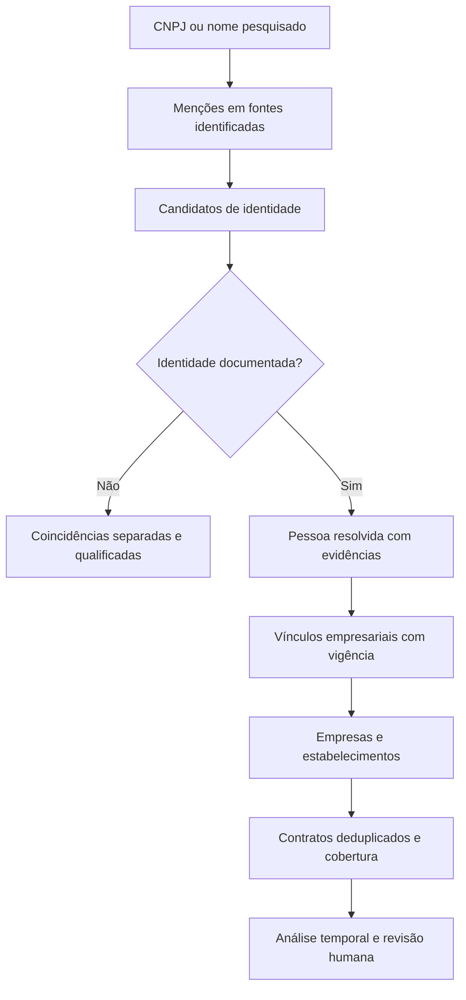

# NEXOFIS — Auditoria do mapa de vínculos e da investigação forense

**Data de referência:** 22/11/2026, America/Bahia.  
**Repositório:** https://github.com/devdudumuniz/NEXOFIS  
**Commit da main analisado:** `0bf6aa8c35432bb427e88639710a416a20e7115d`.  
**Commit anterior da main:** `9c09f555d18cc3bf365a142a55de6f368871a932`.  
**Comparação adicional:** PR #1, commit `7777808d5f6dc5c58ce1490385961e4194494e29`.  
**Natureza:** revisão de código, testes automatizados existentes, experimentos sintéticos e testes HTTP isolados. Nenhum arquivo de aplicação alterado nesta auditoria.

## 1. Parecer executivo

O mapa solicitado já foi implementado na main: busca por CNPJ, razão social e nome de sócio; grafo pessoa → empresa → contrato → órgão; zoom, deslocamento, seleção, tabelas e abertura de dossiês. Essa interface deve ser reaproveitada.

O funcionamento atual é de **explorador do índice local de QSA e contratos**, com enriquecimento pontual. Ainda não realiza descoberta nacional completa de empresas por pessoa. A expansão Empresa 1 → sócio → Empresas 2 e 3 depende de as demais empresas já estarem no índice.

**Parecer: não aprovado como base confiável de investigação forense nesta versão.** Há reproduções de fusão indevida de identidades, soma duplicada de contratos, apontamentos críticos apoiados em referências inexistentes, pacote alterado aceito como válido e restauração incompleta que modifica o destino antes de falhar.

Esse parecer não afirma ocorrência de fraude em contratos reais, nem incidente de exploração do sistema. Os problemas foram demonstrados com dados sintéticos ou delimitados por inspeção de código.

A main não incorporou a PR #1. Ela criou uma implementação paralela com tipos, motor, exportação e persistência diferentes. A tabela `investigation_events` existe nos dois modelos com colunas incompatíveis. A integração exige decisão de modelo e migração explícita.

## 2. Escopo e evidências

Foram examinados os caminhos novos ou alterados relativos ao mapa, conectores, API, persistência, motor forense, interface, exportação, backup, testes e documentação. O commit foi novamente consultado ao fim da análise e continuava sendo a ponta da main.

Os testes adicionais usaram nomes fictícios, respostas HTTP simuladas e bancos temporários. Não foram consultadas pessoas reais. Os arquivos SQLite/WAL versionados tiveram apenas assinatura binária e tamanho conferidos; suas tabelas e conteúdos não foram abertos.

Não houve validação visual em navegador. Achados de estado assíncrono, editor e acessibilidade são identificados como revisão estática, não como falhas visuais observadas.

### Gates executados

| Gate | Resultado | Interpretação |
|---|---|---|
| `npm test` | 88 testes: 87 aprovados, 1 falhou por restrição ambiental | A falha veio do subprocesso `npx tsx`, que tentou abrir um socket IPC e recebeu `EPERM`; não atribuir essa falha à lógica do verificador. |
| `npm run lint` | **Falhou** | O script é `tsc --noEmit`; `partnerNetworkGraph.test.ts:39` usa `legalRegime`, campo inexistente em `ContractRecord`. |
| `npm run build` | Aprovado, com avisos | Bundle principal de aproximadamente 1,45 MB; aviso de chunk acima de 500 kB e aviso sobre configuração futura do Vite. |
| `node --import tsx scripts/smoke-api.ts` | Aprovado | Dez verificações do fluxo existente; não cobre os novos requisitos de identidade e integridade descritos neste relatório. |
| Seis testes dirigidos do mapa | Aprovados | Os testes atuais não cobrem as falhas reproduzidas e alguns legitimam a fusão por nome/CPF parcial. |
| Experimentos de regressão | Problemas reproduzidos | Identidade, temporalidade, deduplicação, evidência, verificador, backup e compatibilidade. |
| HTTP isolado do mapa em modo produção | Falha de controle demonstrada | Leituras e enriquecimento responderam 200 sem token; o endpoint forense respondeu 401 no mesmo servidor. |
| Estado Git após auditoria | Limpo | Nenhuma alteração de código, commit ou publicação nesta rodada. |

Os 147 testes e o CI verde mencionados na entrega anterior pertencem ao commit da PR #1. **Não são evidência de aprovação desta nova main.**

## 3. O que já pode ser reaproveitado

| Capacidade | Estado observado |
|---|---|
| Página própria de rede | Implementada, com parâmetros de consulta e modo na URL. |
| Busca por CNPJ, razão social e nome | Implementada sobre o universo disponível. |
| Grafo SVG em camadas | Implementado: pessoas, empresas, contratos e órgãos. |
| Zoom, deslocamento, seleção e detalhes | Presentes no código; revisão visual ainda pendente. |
| Tabelas e abertura do dossiê | Integradas à navegação. |
| Cache persistente de QSA | Implementado. |
| Aviso de homonímia | Existe para algumas coincidências nominais, mas não impede que alimentem métricas e alertas. |
| Separação de fragmentos documentais diferentes | Presente, porém insuficiente para comprovar a identidade dos fragmentos iguais. |
| Autenticação estrita das rotas forenses | Presente; não abrange as rotas novas do mapa. |
| Upload privado e download vinculado ao contrato | Presentes, com limite de tamanho e conferência do arquivo no download. |
| Controle otimista de edição no backend | Presente, mas o cliente pode usar a versão errada e a revisão humana não exige o digest visto pelo analista. |

## 4. Achados prioritários do mapa

### M01 — P1 — Coincidência nominal torna-se pessoa compartilhada

**Fontes:** [motor do mapa](https://github.com/devdudumuniz/NEXOFIS/blob/0bf6aa8c35432bb427e88639710a416a20e7115d/src/lib/partnerNetworkGraph.ts), linhas 397–427, 593–604, 782–798 e 963–977; [interface](https://github.com/devdudumuniz/NEXOFIS/blob/0bf6aa8c35432bb427e88639710a416a20e7115d/src/components/PartnerNetworkView.tsx), linhas 796–821.

Menções de mesmo nome são agrupadas em um nó. Quando nome e CPF parcial coincidem, o cluster recebe `name_and_masked_cpf`, sem aviso de homônimo, e suas arestas são sólidas. Mesmo a coincidência apenas nominal, que recebe ressalva, expande empresas e alimenta o alerta de órgão compartilhado.

**Reprodução:** duas empresas com menções de mesmo nome, sem evidência de identidade, produziram duas empresas, uma pessoa e um órgão compartilhado. Ao fornecer o mesmo CPF parcial, o aviso de homônimo desapareceu.

**Correção:** manter cada menção de origem separada. Usar coincidência como candidatura à resolução de identidade. Uma pessoa documentalmente resolvida precisa de ID opaco e evidência explícita. Candidatos não devem alimentar métricas de sócio comprovadamente comum.

### M02 — P1 funcional — Descoberta de empresas limitada ao índice local

**Fonte:** [rotas](https://github.com/devdudumuniz/NEXOFIS/blob/0bf6aa8c35432bb427e88639710a416a20e7115d/server.ts), linhas 1348–1363 e 1413–1466; motor do mapa, linhas 531–537.

O enriquecimento seleciona CNPJs já presentes nos contratos locais. A busca por empresário percorre os clusters já indexados. O PNCP é consultado somente para o CNPJ inicial, e a busca textual de empresas enriquece até três empresas conhecidas.

**Consequência:** empresas desconhecidas do índice não aparecem. Os contratos de todas as empresas secundárias também não são atualizados automaticamente.

**Correção:** separar descoberta empresarial de coleta de contratos. Indexar uma fonte de vínculos com cobertura definida ou importar vínculos documentados; depois coletar contratos por CNPJ descoberto. Informar universo, data e limites em cada etapa.

### M03 — P1 — Contratos espelhados duplicam quantidades e valores

**Fonte:** motor do mapa, linhas 342–345, 650, 686 e 1023.

A deduplicação considera apenas `contract.id`. Dois registros com IDs locais diferentes e o mesmo controle PNCP permanecem na soma.

**Reprodução:** dois espelhos com mesmo `pncpControlNumber`, cada um no valor de 100, produziram `contractCount=2` e `totalContractValue=200`.

**Correção:** identidade canônica pelo controle PNCP quando disponível, regras explícitas para fontes sem identificador e tratamento de valores divergentes. Validar valores finitos e a semântica de `updatedValue || originalValue`.

### M04 — P2 — Carteira histórica da empresa é atribuída ao sócio atual

**Fonte:** motor do mapa, linhas 418–423, 647–674 e 718–725.

O modelo carrega a entrada do sócio, mas soma todos os contratos da empresa sem usar esse período. Não existe data de saída no modelo do mapa.

**Reprodução:** entrada societária em 2026, contratos assinados em 2020; os contratos foram agregados às métricas da pessoa.

**Correção:** distinguir carteira histórica da empresa de contratos durante vínculo societário comprovado. Usar estados separados: vínculo atual observado, comprovado na data e período desconhecido.

### M05 — P1/P2 — Consulta PNCP parcial ou indisponível fica invisível

**Fonte:** rotas, linhas 1421–1430 e 1482–1490; interface, linhas 1655–1657.

A coleta usa no máximo três páginas, engole exceções e devolve apenas contagens do índice. Não entrega ao usuário estado PNCP, quantidade de páginas, truncamento ou indisponibilidade. A mensagem de ausência menciona banco local ou PNCP mesmo quando a consulta pode ter falhado ou não ter sido feita para as empresas secundárias.

**Correção:** cobertura por fonte e CNPJ, checkpoints, estado parcial/indisponível/não consultado e motivo. Resultado vazio não pode substituir um erro de aquisição.

### M06 — P2 — Órgãos diferentes são unidos pelo nome

**Fonte:** motor do mapa, linhas 764 e 992.

A chave usa nome normalizado e município, ignorando `entityId` disponível nos contratos.

**Reprodução:** `ORG1` e `ORG2`, com mesmo nome e município, tornaram-se um órgão e geraram contagem de órgão compartilhado.

**Correção:** identificador canônico de órgão/unidade; fallback nominal com incerteza explícita, sem converter em identidade comprovada.

### M07 — P2 — Há truncamento silencioso de resultados e do desenho

**Fonte:** motor do mapa, linhas 589, 616 e 810; interface, linhas 1134–1145.

Os limites de cinco empresas-semente e oito pessoas-semente reduzem o resultado da busca sem total de candidatos ou continuação. O desenho limita empresas a oito, mas não existe `visualCompaniesTruncated`.

**Reproduções:** nove pessoas correspondentes retornaram oito; nove empresas-semente retornaram cinco; um resultado com nove empresas listadas desenhou oito. Os flags de sócios e contratos permaneceram falsos.

**Correção:** separar paginação de candidatos de limites visuais; retornar total, cursor e flags de cada camada.

### M08 — P2 — Respostas fora de ordem e contexto de sessão

**Fonte:** interface, linhas 121–159, 165–173 e 186–202; [App](https://github.com/devdudumuniz/NEXOFIS/blob/0bf6aa8c35432bb427e88639710a416a20e7115d/src/App.tsx), linhas 968–973.

Não há cancelamento nem versão de requisição. Uma busca anterior pode sobrescrever a nova. Erros mantêm o payload anterior. A hidratação compara a query, mas não o modo. O componente não recebe identidade da sessão para limpar dados ao mudar de usuário.

**Evidência:** inspeção estática, sem reprodução visual.

**Correção:** AbortController/identificador de consulta, estado explícito de resultado obsoleto, chave por sessão e sincronização de query + modo.

### M09 — P2 — Nós sem operação equivalente por teclado

**Fonte:** interface, linhas 940 e 1082–1090.

Os nós são grupos SVG com click/hover, sem tabulação, papel de controle e eventos de teclado. As tabelas oferecem ações alternativas parciais.

**Evidência:** inspeção estática.

**Correção:** controles focáveis, rótulos, seleção por teclado, foco visível e alternativa tabular equivalente; validar em navegador.

## 5. Segurança e integridade

### F01 — P1 — Histórico não protege os fatos usados pela análise

**Fontes:** [storage](https://github.com/devdudumuniz/NEXOFIS/blob/0bf6aa8c35432bb427e88639710a416a20e7115d/src/server/storage.ts), linhas 891–923 e 1335–1404; rotas, linhas 1632–1670.

O evento `FACTS_UPDATED` guarda versão e contagens, não snapshot nem digest do conteúdo. Os fatos ficam em `investigation_cases.facts_json`, mutável. O carregamento não interrompe a avaliação quando a cadeia falha.

**Reprodução:** depois de salvar um caso sintético, foi alterada somente a data empresarial em `facts_json`, sem tocar no ledger. O resultado mudou para empresa recente, mas a cadeia permaneceu válida e a exportação passou com `VALID/exitCode=0`.

```json
{"chain":{"valid":true,"eventCount":2},"offline":"VALID","exitCode":0,"recentFinding":"APONTAMENTO"}
```

**Correção:** cada revisão preserva o conjunto completo e digest; o estado analisado precisa corresponder à última revisão válida; falha de integridade interrompe a análise. A PR anterior contém esse padrão.

### F02 — P1 — Referências inexistentes geram evidência afirmada como documentada

**Fonte:** [motor forense](https://github.com/devdudumuniz/NEXOFIS/blob/0bf6aa8c35432bb427e88639710a416a20e7115d/src/lib/forensicInvestigationEngine.ts), linhas 255–270, 417, 638–645, 1014–1038 e 1202–1211.

O motor recebe `privateEvidence`, mas não o usa na avaliação. Em vários cruzamentos, basta `identityStatus='documented'` e uma lista não vazia de referências. O validador também aceita IDs duplicados.

**Reprodução:** com acervo vazio e `evidenceRefs=['nonexistent-proof']`, foi gerado `APONTAMENTO/CRÍTICA` afirmando vínculo empresarial documentado. Duas pessoas com mesmo ID foram aceitas; a resolução pelo Map usa o último registro.

**Correção:** unicidade, integridade referencial, evidência de identidade e verificação dos bytes preservados. Alegação do cliente não equivale a documento validado.

### F03 — P1 — Nexo funcional e temporalidade indevidos

**Fonte:** motor forense, linhas 74–86, 449–490, 570–600, 1022–1030 e 1172–1175.

Foram reproduzidos três problemas:

1. Função sintética de motorista, `pertinentToContract=false`, órgão de mesmo nome: apontamento crítico afirma função pertinente.
2. Fim de vigência `null` ou `broken`: `isDateWithinInterval` retorna `within`.
3. Constituição em 2099-01-01 e assinatura em 2099-01-02, com avaliação em 2026: apontamento crítico de empresa recente.

**Correção:** funções elegíveis e relação específica com o contrato; datas futuras/impossíveis são inconsistências; ausência de limite comprovado permanece desconhecida. A empresa recente continua sendo contexto de diligência, não prova de ilícito.

### F04 — P1 — Verificador aceita relatório divergente do replay

**Fonte:** motor forense, linhas 1575–1585, 1657–1676 e 1687–1715.

O replay compara um subconjunto dos campos. Resumo, cronologia e outros componentes não entram na comparação integral. Originais só são conferidos quando aparecem na lista correspondente.

**Reproduções:**

- Pacote com apontamento crítico baseado em referência inexistente, acervo vazio e eventos vazios: `VALID/exitCode=0`, zero originais conferidos.
- Resumo de achado e cronologia alterados, digest externo recalculado: `VALID/exitCode=0` e `reproductionMatches=true`.

Recalcular um hash não autentica um pacote. O problema adicional comprovado é o verificador afirmar reprodução compatível quando o relatório não corresponde integralmente à saída do motor.

**Correção:** comparar integralmente o relatório reproduzido e verificar correspondência entre snapshot, ledger, manifesto, referências e bytes. Distinguir integridade, incompletude e autenticidade externa.

### F05 — P1 — Restauração incompleta modifica o destino antes de falhar

**Fonte:** [backup](https://github.com/devdudumuniz/NEXOFIS/blob/0bf6aa8c35432bb427e88639710a416a20e7115d/scripts/backup-restore.sh), linhas 170–201, 249–254, 274–314.

Sem archive privado, o verificador recebe diretório vazio e pula a conferência de originais. A restauração substitui o banco antes de detectar que os arquivos faltam. Não há rollback dessa situação; os diretórios anteriores são removidos após a troca.

**Reprodução:** backup sintético completo foi copiado sem o archive privado. A verificação aprovou; a restauração retornou erro, mas já havia criado/substituído o banco de destino.

```json
{"verifyExit":0,"verifyReportedIntegrity":true,"restoreExit":1,"restoredDb":true,"restoredPrivateDirectory":false}
```

**Correção:** validar todo o conjunto antes de modificar o destino; manifestar originais a partir do snapshot; exigir archive quando referenciado; conservar banco e arquivos anteriores; restaurar com aplicação parada e procedimento de rollback.

### F06 — P1 — Mapa permite coleta e escrita anônimas

**Fonte:** rotas, linhas 1334, 1344 e 1395.

Os endpoints de sugestões, mapa e enriquecimento não recebem middleware de autenticação. O GET do mapa também consulta provedores e persiste QSA/contratos. Não exige ator, finalidade ou justificativa; respostas não indicam `Cache-Control` restritivo.

**Reprodução HTTP:** em servidor temporário de produção com autenticação habilitada, consultas e enriquecimento retornaram 200 sem token; o endpoint forense retornou 401. Foram usados apenas dados sintéticos já cacheados, sem chamadas externas.

**Correção:** permissões explícitas para leitura e aquisição, separação GET de snapshot/POST de coleta, ator e motivo, limites de concorrência e limpeza de dados na troca de sessão. Uma eventual visualização pública deve usar uma projeção deliberadamente pública, separada do acervo investigativo.

### F07 — P1 — Conector aceita CNPJ divergente e documento completo

**Fonte:** [adaptador cadastral](https://github.com/devdudumuniz/NEXOFIS/blob/0bf6aa8c35432bb427e88639710a416a20e7115d/src/server/connectors/brasilApiCadastral.ts), linhas 48–122; rotas, linhas 1216–1274; motor do mapa, linhas 207–215; interface, linhas 1597–1598.

O adaptador forense valida somente o comprimento numérico, não compara o CNPJ retornado com o solicitado, lê JSON sem limite de bytes e aceita o redirecionamento padrão. O campo `maskedDocument` recebe o valor sem assegurar máscara. O conector separado do mapa apresenta problemas equivalentes e desarma seu timeout antes de consumir o corpo.

**Reprodução com HTTP simulado:** resposta de outro CNPJ foi aceita; documento sintético com 11 dígitos permaneceu integral no extrato. O normalizador do mapa também aceita e sua UI exibe esse valor.

Não foi verificado se existem CPFs completos reais na instalação. O achado é a ausência de uma barreira de minimização.

**Correção:** unificar conectores, conferir CNPJ exato e dígitos verificadores, limitar leitura, manter timeout até o fim do corpo, recusar redirecionamentos e rejeitar/redigir documento completo antes de persistir e responder.

### F08 — P1 — Editor e revisão podem usar fatos que o usuário não viu

**Fontes:** [aba forense](https://github.com/devdudumuniz/NEXOFIS/blob/0bf6aa8c35432bb427e88639710a416a20e7115d/src/components/ForensicInvestigationTab.tsx), linhas 261, 292, 336–339 e 383; rotas, linhas 2018–2065.

O editor salva usando a versão atual de `caseData`, embora seu texto possa ter sido iniciado na versão anterior. Upload ou sincronização atualizam o caso sem atualizar a versão-base do editor. Uma edição antiga pode, assim, ser enviada com a versão nova e passar no CAS.

A revisão recebe ID do achado, ação e motivo; recalcula o estado e grava o digest atual do servidor. Não recebe o digest que o usuário estava revisando. Uma decisão enviada de tela antiga pode ser vinculada aos fatos novos.

**Evidência:** fluxo de código, sem reprodução visual.

**Correção:** capturar versão/digest ao abrir editor ou achado; preservar essa referência até enviar; retornar 409 e exigir conciliação quando houver divergência. A PR anterior já aplica esse princípio.

### F09 — P2 — Participantes de lote podem compartilhar pessoa sem vínculo comprovado

**Fonte:** motor forense, linhas 1355–1378.

O cruzamento usa `linkedPersonIds` dos participantes, sem exigir vínculo correspondente em `corporateLinks` válido na data do evento.

**Reprodução:** dois participantes, uma pessoa marcada como documentada, referências inexistentes e nenhum vínculo empresarial produziram apontamento alto de vínculo simultâneo.

**Correção:** comprovar separadamente identidade, vínculo empresarial, participação no lote e vigência.

### F10 — P2 — CLI segue symlinks e não limita tamanho dos arquivos

**Fonte:** [verificador CLI](https://github.com/devdudumuniz/NEXOFIS/blob/0bf6aa8c35432bb427e88639710a416a20e7115d/scripts/verify-investigation.ts), linhas 30–48 e 72–76.

A conferência usa caminho textual; as operações de arquivo seguem links simbólicos. Pacote e originais são lidos sem limite de tamanho.

**Evidência:** revisão de código; não foi explorada leitura de arquivos externos.

**Correção:** caminho real confinado, política explícita para links, limites de bytes e de complexidade estrutural.

## 6. Integração e higiene do repositório

### I01 — Bloqueador — Schemas incompatíveis entre main e PR #1

**Fontes:** storage da main, linhas 350–366; [store da PR](https://github.com/devdudumuniz/NEXOFIS/blob/7777808d5f6dc5c58ce1490385961e4194494e29/src/server/investigationStore.ts).

| Implementação | Colunas de `investigation_events` |
|---|---|
| Main atual | `seq`, `event_type`, `actor_id`, `facts_version`, `payload_json`, `prev_hash` etc. |
| PR #1 | `contract_id`, `sequence`, `kind`, `event_json`, `previous_event_hash` etc. |

**Reprodução:** banco sintético criado pelo store da main foi aberto pelo store da PR: `no such column: sequence`.

Tipos, códigos de regras e formatos de exportação também divergem. Um merge mecânico ou simples substituição de arquivos não é uma migração.

**Correção:** definir modelo canônico; preservar revisões e eventos antigos; criar conversão explícita e reversível, sem inventar provas retroativas para eventos que só guardaram contagens. Revisões legadas sem snapshot verificável precisam manter essa limitação.

### I02 — P1 de higiene — Banco e WAL de runtime continuam versionados

A árvore da main contém um SQLite de **937.984 bytes** e um WAL de **4.120.032 bytes**, identificados somente por cabeçalho e metadados. Os nomes não são reproduzidos neste relatório. A `.gitignore` não contempla as exclusões adicionais propostas na PR anterior.

**Correção:** avaliar privadamente a natureza dos dados, retirar artefatos de runtime da árvore e impedir novos commits. A remoção do commit atual não elimina objetos históricos. Rotação de credenciais ou reescrita de histórico dependem da confirmação do conteúdo e de procedimento próprio; esta auditoria não realizou essas ações.

### I03 — Gate real de typecheck quebrado

**Fonte:** [teste do mapa](https://github.com/devdudumuniz/NEXOFIS/blob/0bf6aa8c35432bb427e88639710a416a20e7115d/src/lib/partnerNetworkGraph.test.ts), linha 39.

```text
TS2353: 'legalRegime' does not exist in type 'ContractRecord'.
```

**Correção:** adequar o fixture ao contrato real de tipos. Não contornar com `any`, desabilitar o teste ou mudar o typecheck para excluir a suíte.

## 7. Modelo recomendado para o mapa

Separar quatro camadas evita que a visualização crie fatos inexistentes:



Uma correspondência de nome pode ajudar a encontrar candidatos. Não deve converter diretamente contratos das empresas em patrimônio, receita ou participação histórica da pessoa.

Contratos devem continuar pertencendo às empresas. A relação da pessoa com esses contratos depende do vínculo societário ou funcional e do período comprovado. Somatórios devem ser identificados como valores contratuais observados, sem confusão com pagamentos ou benefício pessoal.

## 8. Plano de correção e critérios de aceite

### Etapa 1 — Consolidar a base e fechar os bloqueadores

1. Preservar a UI e a navegação novas do mapa.
2. Escolher um único modelo canônico de investigação e mapear todas as diferenças entre main e PR.
3. Implementar migração testada em cópia sintética/QA, com rollback, sem sobrescrever acervo existente.
4. Recuperar os controles da PR que ligam snapshot, digest, eventos, originais e replay integral.
5. Corrigir restauração antes de trocar o destino, conector, autorização e gate de tipos.
6. Tratar os artefatos de runtime versionados sem expor seu conteúdo.

**Aceite:** fatos alterados fora da trilha deixam de produzir pacote aprovado; restore incompleto não modifica destino; requisições de aquisição sem autorização são rejeitadas; migração preserva eventos e distingue limitações legadas; typecheck passa sem supressões.

### Etapa 2 — Corrigir o mapa como ferramenta de investigação

1. Menções e candidatos separados de identidades comprovadas.
2. Vínculos documentais e intervalos temporais.
3. Deduplicação por controle PNCP e tratamento de divergência.
4. Órgão canônico por identificador confiável.
5. Paginação dos candidatos e aviso de truncamento em cada camada.
6. Cobertura por empresa/fonte, incluindo consulta não feita e indisponibilidade.
7. Proteção contra respostas antigas e troca de sessão; operação por teclado.

**Aceite:** os casos sintéticos M01–M09 passam com resultados esperados documentados; nenhum candidato nominal aparece como prova societária; contratos antigos são rotulados corretamente; soma de espelhos não duplica gastos.

### Etapa 3 — Ampliar descoberta e homologar

1. Criar ingestão reversa de QSA com origem, período, atualização e cobertura definidos.
2. Permitir importação de vínculos comprovados e resolução humana de candidatos com histórico.
3. Atualizar contratos por CNPJ de cada empresa encontrada, com progresso, limites, retry e checkpoints.
4. Validar ponta a ponta em navegador e por HTTP, com dados sintéticos e casos autorizados.
5. Executar testes, typecheck, build, revisão de secrets e recuperação antes de publicar a consolidação.

**Aceite:** uma pessoa documentada vinculada a três empresas mostra os contratos deduplicados das três, a origem de cada relação, o período e o que ainda não foi consultado. Uma consulta vazia nunca é apresentada como prova de ausência nacional.

## 9. Regressões mínimas obrigatórias

- Dois homônimos sem documento permanecem pessoas/candidatos separados.
- Nome e fragmento de CPF iguais não equivalem a identidade comprovada.
- Referência documental inexistente bloqueia a afirmação de vínculo documentado.
- IDs duplicados ou referências órfãs são recusados.
- Sócio que entrou depois do contrato não recebe participação histórica presumida.
- Datas inválidas, futuras e intervalos desconhecidos permanecem inconclusivos.
- Mesmos contratos com IDs locais diferentes são deduplicados pelo controle canônico.
- Divergência entre espelhos é exibida e impede soma enganosa.
- Órgãos diferentes não se fundem por nome.
- Resultados truncados informam total, limite e continuação.
- Falha do PNCP retorna estado de indisponibilidade/consulta parcial.
- Leitura e aquisição respeitam as permissões definidas; GET não inicia coleta persistente.
- CNPJ divergente na resposta cadastral é recusado.
- Documento completo em campo supostamente mascarado é minimizado antes de persistir e responder.
- Edição e revisão obsoletas retornam conflito, sem associação automática a novos fatos.
- Mudança no snapshot sem revisão correspondente invalida a análise/exportação.
- Resumo, cronologia e outros campos alterados invalidam a reprodução integral.
- Ausência de original obrigatório retorna incompleto ou rejeição conforme a operação, nunca sucesso artificial.
- Restore incompleto deixa banco e arquivos do destino intactos.
- Migração main → modelo canônico é ensaiada e reversível.
- Respostas fora de ordem não sobrescrevem a consulta atual.
- Troca de usuário limpa resultados restritos.
- Nós e detalhes podem ser operados por teclado.

## 10. Decisão recomendada

**Aproveitar o mapa existente e corrigir suas garantias antes de ampliar a coleta.** Reconstruir a interface desperdiçaria trabalho. Manter dois motores e dois schemas de investigação aumentaria o risco de regressão e divergência de provas.

A main atual é um avanço de produto e navegação. O próximo passo técnico é consolidá-la com os controles efetivamente verificados da PR anterior, com migração explícita, testes de regressão das falhas reproduzidas e cobertura de aquisição declarada.

### Referências de controle

- [Commit auditado](https://github.com/devdudumuniz/NEXOFIS/commit/0bf6aa8c35432bb427e88639710a416a20e7115d)
- [PR #1](https://github.com/devdudumuniz/NEXOFIS/pull/1)
- [Commit da PR anterior](https://github.com/devdudumuniz/NEXOFIS/commit/7777808d5f6dc5c58ce1490385961e4194494e29)
- [Tipos atuais de investigação](https://github.com/devdudumuniz/NEXOFIS/blob/0bf6aa8c35432bb427e88639710a416a20e7115d/src/types/investigation.ts)
- [Documentação atual da investigação](https://github.com/devdudumuniz/NEXOFIS/blob/0bf6aa8c35432bb427e88639710a416a20e7115d/docs/INVESTIGACAO_FORENSE.md)

